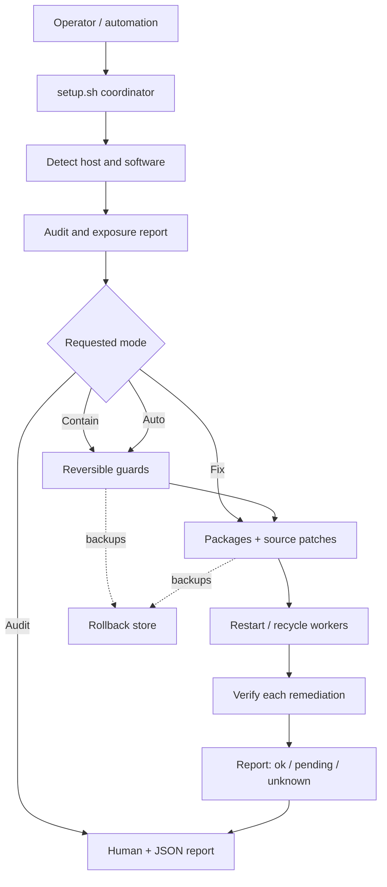
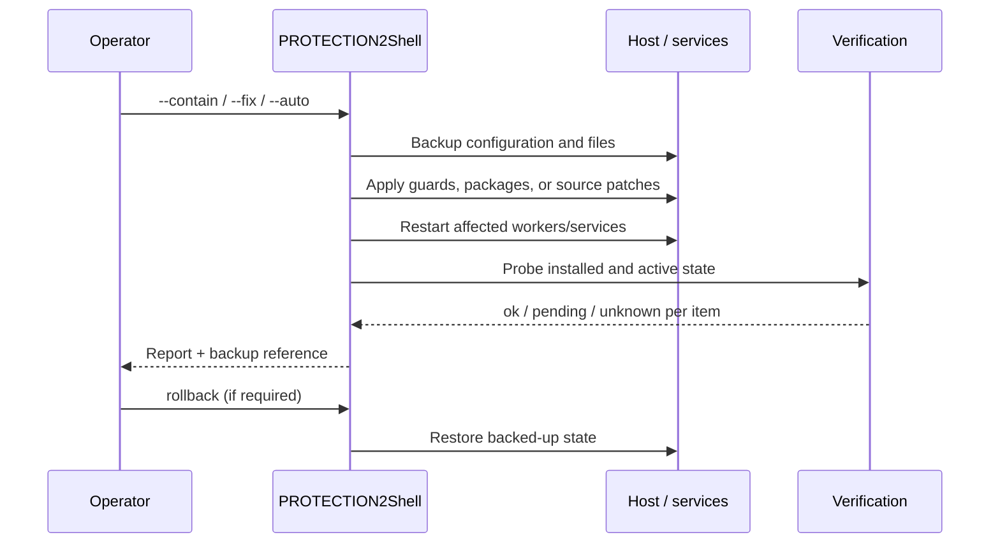
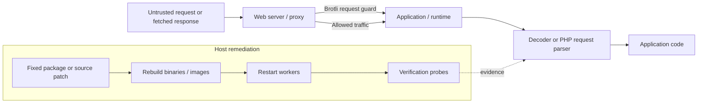

# PROTECTION2Shell: A Reversible, Verification-Driven Toolkit for Containment and Remediation of PHP2Shell and HTTP2Shell Vulnerability Families

**ESS KS Life Tech**  
Version 1.0 · 5 November 2026  
Preprint — not peer reviewed

## Abstract

Internet-facing services frequently depend on vulnerable components embedded in application runtimes, language packages, and vendored source trees. In these environments, package-level inventory and version checks may fail to identify the code actually executing, while a configuration-only mitigation may reduce exposure without eliminating the underlying defect. PROTECTION2Shell is a dependency-free, Bash-based defensive toolkit designed to address this operational gap for two vulnerability families: PHP2Shell (CVE-2026-109618 and CVE-2026-109619), HTTP2Shell/Brotli decoder flaw (CVE-2026-111497), and selected legacy PHP vulnerabilities (CVE-2024-4577 and CVE-2019-11043). The toolkit organizes response into an auditable sequence: read-only discovery and assessment; reversible containment; package and source-level remediation; worker or service restart; and post-change verification. It also supports rollback, JSON reporting, dry-run execution, and post-remediation compromise hunting. This paper describes the system architecture, threat model, remediation workflow, design rationale, and current validation approach. It does not claim that the tool eliminates all exploit paths or substitutes for vendor advisories, incident response, or independent security review.

**Keywords:** vulnerability remediation, PHP, Brotli, incident response, containment, source patching, verification, rollback, software supply chain

## 1. Introduction

Security response is often split across separate tools: vulnerability scanners identify versions, configuration management applies mitigations, package managers install updates, and operators manually restart services and check whether the fix took effect. This separation creates several failure modes:

- A patched system library may coexist with a vulnerable vendored copy.
- A package can report an upstream version string despite carrying a downstream patch, or retain a version string after a fix is cherry-picked.
- A configuration mitigation can be mistaken for a permanent fix.
- A patched file on disk does not protect a long-lived process that still has vulnerable code loaded.
- Changes made during an incident can be difficult to reverse or audit.

PROTECTION2Shell addresses these workflow risks by combining detection, containment, remediation, restart, verification, reporting, and rollback in one operational pipeline. Its design goal is not to replace general-purpose vulnerability management. It is to provide a focused, reproducible response for the vulnerability families documented in the repository.

### Contributions

This preprint documents five engineering contributions:

1. A staged response pipeline that distinguishes temporary containment from permanent remediation.
2. Multi-carrier detection that considers runtimes, libraries, Python environments, and vendored source trees.
3. Reversible configuration and source changes with backup-based rollback.
4. Verification that reports per-item states rather than treating a successful command or version string as proof.
5. A dependency-free implementation with Bash 3.2 compatibility, intended to operate across common Linux distributions, macOS, Windows Git Bash detection, and container environments.

## 2. Scope and vulnerability coverage

The toolkit currently maps the following issues to detection and remediation logic. Version information is maintained in the repository knowledge base and should be checked against the relevant vendor or distribution advisory before operational use.

| Identifier | Family / component | Toolkit response |
|---|---|---|
| CVE-2026-109618 | PHP2Shell: request-setup OOM corruption | PHP detection, hardening guidance, fixed-package/source remediation, restart and verification |
| CVE-2026-109619 | PHP2Shell: stale request-global state | PHP detection, session upload-progress mitigation, fixed-package/source remediation, restart and verification |
| CVE-2026-111497 | HTTP2Shell: Brotli decoder out-of-bounds write | Brotli carrier detection, containment guards, fixed releases/source patches, restart and verification |
| CVE-2024-4577 | PHP-CGI argument injection | PHP-CGI detection and remediation guidance |
| CVE-2019-11043 | PHP-FPM path-info underflow | PHP-FPM detection and remediation guidance |
| CVE-2026-115560 | PHP session serialization advisory / emerging vector | Interim hardening status and explicit uncertainty |

The tool does not treat every detected installation as remotely exploitable. Exposure depends on deployment, reachable parsing paths, build configuration, and vendor backports. Its report is intended to make uncertainty visible.

## 3. Threat model and operating assumptions

### 3.1 Assets

The primary assets are the integrity and availability of web-serving hosts, PHP worker processes, services that decode Brotli data, and the configuration and source files required to remediate those services.

### 3.2 Adversary

The assumed adversary can send unauthenticated requests to exposed services or cause a service to fetch attacker-controlled content. The toolkit does not assume that the attacker has shell access. Host remediation itself requires appropriate administrator privileges.

### 3.3 Trust boundaries

The response pipeline crosses four trust boundaries:

- **Network input:** request bodies and compressed content are potentially hostile.
- **Runtime boundary:** application code may execute only after vulnerable parsing has already occurred.
- **Build and dependency boundary:** source may be vendored or statically linked and therefore absent from the operating system package inventory.
- **Operations boundary:** applying fixes may restart services, alter configuration, or upgrade packages.

The toolkit assumes operators have authorization to administer the target host. It recommends staging validation before production changes and preserves backups for changes it makes.

## 4. System architecture

The implementation is organized around a coordinator and focused modules for detection, containment, remediation, verification, reporting, and rollback.

**Figure 1.** High-level control flow. Audit is read-only. Mutating modes create backups and route through verification; containment and remediation remain distinct reportable stages.

### 4.1 Main components

| Component | Responsibility |
|---|---|
| `setup.sh` | Orchestrates detect → audit → contain → fix → verify → report |
| `lib/detect.sh`, `lib/detect_brotli.sh` | Host, PHP, web-server, runtime, library, and vendored-source discovery |
| `lib/cve_db.sh`, `lib/brotli_db.sh` | Vulnerability knowledge, verdicts, capability probes |
| `lib/contain.sh` | Edge and in-process guards, PHP hardening, optional quarantine |
| `lib/fix.sh` | Package updates, configuration changes, source patches |
| `lib/verify.sh` | Per-item verification states |
| `lib/report.sh` | Human-readable and JSON output |
| `rollback.sh` | Restore backed-up files and quarantine contents |
| `hunt/hunt.sh` | Post-remediation indicators and compromise checks |

## 5. Response workflow

### 5.1 Discovery and audit

The default invocation performs read-only detection and reports identified software, potential exposure, and remediation status. Optional JSON output supports integration with automation. Detection covers package metadata and runtime-specific evidence, including Node.js/Bun, Python Brotli modules, .NET runtimes, curl, PHP, Envoy/Istio, and selected vendored trees.

### 5.2 Containment

Containment reduces reachable exploit paths while operators prepare or schedule permanent remediation. Examples include:

- Rejecting Brotli-compressed request bodies at supported web-server edges.
- Installing fail-closed in-process guards for Node.js/Bun and Python decompression paths.
- Applying PHP session upload-progress hardening and recycling workers.
- Optionally quarantining webshell-shaped files into a reversible backup set.

Containment is explicitly not labeled as a permanent fix. Edge controls cannot cover all outbound decompression paths, and request-size limits do not reliably block smaller denial-of-service inputs.

### 5.3 Permanent remediation

The remediation order prioritizes vendor or distribution fixed packages, then official fixed releases, then verified source patches for vendored or unmanaged copies. Configuration mitigations and migration plans are reported separately when an affected branch is unsupported.

Source patching is designed to preserve provenance and testability: the repository includes patch application scripts and patch documentation. Operators should inspect changes and validate builds in staging before deployment.

### 5.4 Restart and verification

A remediation is not complete merely because a file was changed. Services and workers must reload the corrected code. Verification reports each item as:

- **ok** — evidence supports successful remediation;
- **pending** — an action or restart remains outstanding;
- **unknown** — available evidence cannot establish the state.

For Brotli, capability probes supplement version metadata because downstream builds may backport fixes without changing upstream version strings. Absence of a known fixed marker is treated as uncertainty, not automatic proof of vulnerability.

**Figure 2.** Mutation lifecycle, including verification and rollback.

## 6. Containment and remediation layers

**Figure 3.** Defense layers. Edge controls reduce inbound exposure, but permanent remediation must reach the code actually loaded by each process, including vendored copies and rebuilt artifacts.

The toolkit documents important limitations: rejecting Brotli requests may affect legitimate clients; an edge proxy cannot prevent a vulnerable service from decoding attacker-controlled outbound responses; container environments may require an external restart; and unsupported runtime branches may require migration or vendor-maintained fixes.

## 7. Implementation and portability

The implementation uses Bash and common Unix utilities, with Bash 3.2 as the compatibility floor. It avoids a mandatory package installation or compilation step for the core audit and containment workflow. Optional capabilities—such as configuration validation, source compilation, and JSON test validation—degrade gracefully when tools are absent.

Supported environments documented by the project include major Debian- and RPM-based distributions, Alpine, Arch, SUSE, macOS, Windows detection under Git Bash, and containers. Privileged operations require root or equivalent permissions. The project provides `--dry-run`, `--yes`, `--json`, and rollback options for controlled operation.

## 8. Validation approach and evidence

The repository includes a self-test suite at `tests/run-tests.sh`, intended to run without root. The Brotli patch documentation describes application to pristine upstream source, compilation, round-trip testing, and checking the fixed decoder's error behavior. These are project-reported validation activities, not an independent third-party evaluation.

This preprint does not publish a comprehensive benchmark, a host-by-host detection sensitivity study, or a formal proof of remediation completeness. Those remain necessary for stronger claims. A useful independent evaluation should include:

1. A representative matrix of distributions, runtime versions, package backports, and vendored dependency layouts.
2. Positive and negative tests for every detector and verifier.
3. Fault injection for failed package updates, failed configuration validation, interrupted restarts, and rollback.
4. Compatibility testing for legitimate Brotli traffic and PHP application behavior.
5. Independent review of root-privileged shell operations and patch provenance.

## 9. Limitations and responsible use

PROTECTION2Shell is a focused operational toolkit, not a general endpoint detection and response platform, exploit detector, or guarantee of system safety. A clean report cannot establish that a host was never compromised. Post-patch compromise hunting is a triage aid and may miss indicators. Detection can be limited by inaccessible paths, containers, static binaries, custom builds, or unknown vendoring.

Operators should:

- Confirm advisory and fixed-version information with upstream vendors and their distribution.
- Test `--fix` in staging and review the generated report.
- Understand that `--auto` may upgrade packages and restart services without interactive prompts.
- Use the toolkit only on systems they own or are authorized to administer.
- Preserve logs and conduct incident response if exploitation is suspected.

## 10. Conclusion

PROTECTION2Shell packages a practical defensive sequence around a recurring systems problem: vulnerability remediation is incomplete until the affected code is identified, changes are applied, active processes are restarted, and the result is checked. Its emphasis on reversible containment, source-aware remediation, and explicit verification states is intended to reduce operational ambiguity during response. Broader claims about coverage and effectiveness require independent testing across real deployments.

## Availability

Source code, tests, patch artifacts, and operational documentation:

- Repository: https://github.com/esskslifetech/PROTECTION2Shell
- Legacy repository slug (same project): https://github.com/esskslifetech/php-secure-patch
- License: MIT

## References and project documentation

1. PROTECTION2Shell repository README and implementation documentation. https://github.com/esskslifetech/PROTECTION2Shell
2. HTTP2Shell technical dossier. https://github.com/esskslifetech/PROTECTION2Shell/blob/main/docs/HTTP2SHELL.md
3. PHP2Shell technical research. https://github.com/esskslifetech/PROTECTION2Shell/blob/main/SECURITY-RESEARCH.md
4. Brotli upstream project and releases. https://github.com/google/brotli
5. PHP security advisories. https://www.php.net/security/
6. CISA Known Exploited Vulnerabilities Catalog. https://www.cisa.gov/known-exploited-vulnerabilities-catalog

---

*This document is a technical preprint authored by ESS KS Life Tech. It has not undergone peer review. Vulnerability details and fixed-version guidance can change; consult upstream advisories before acting.*
